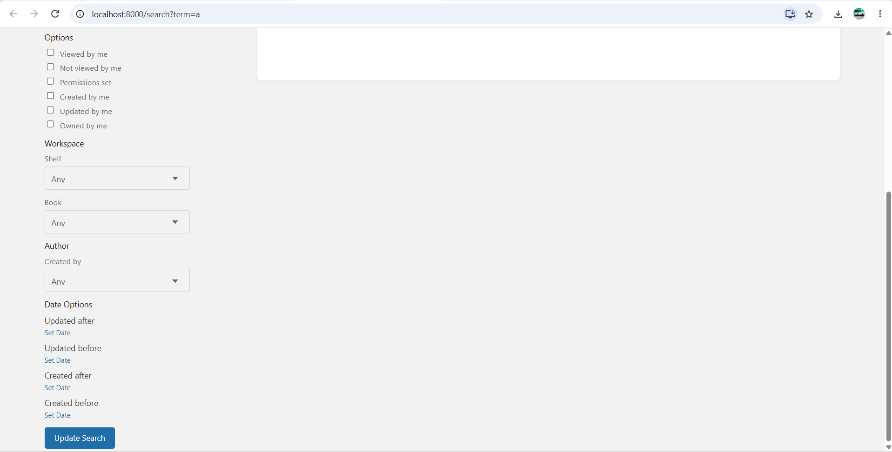
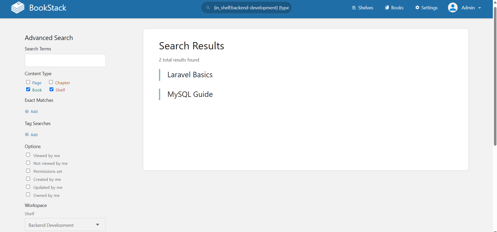
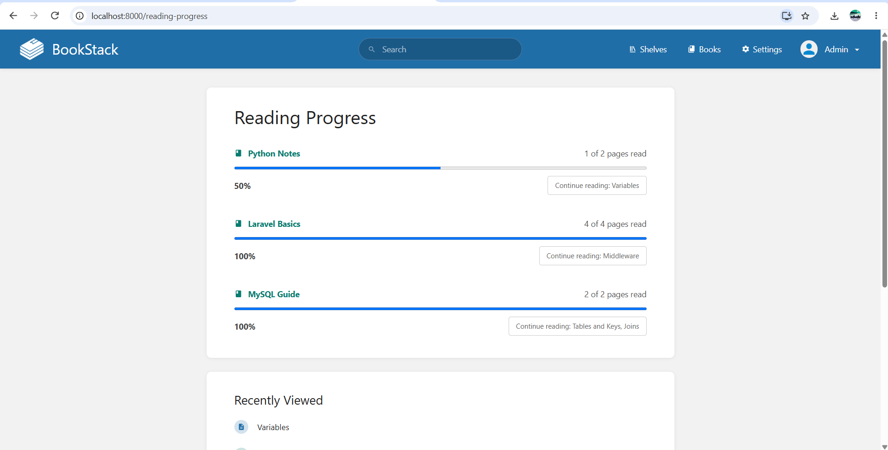
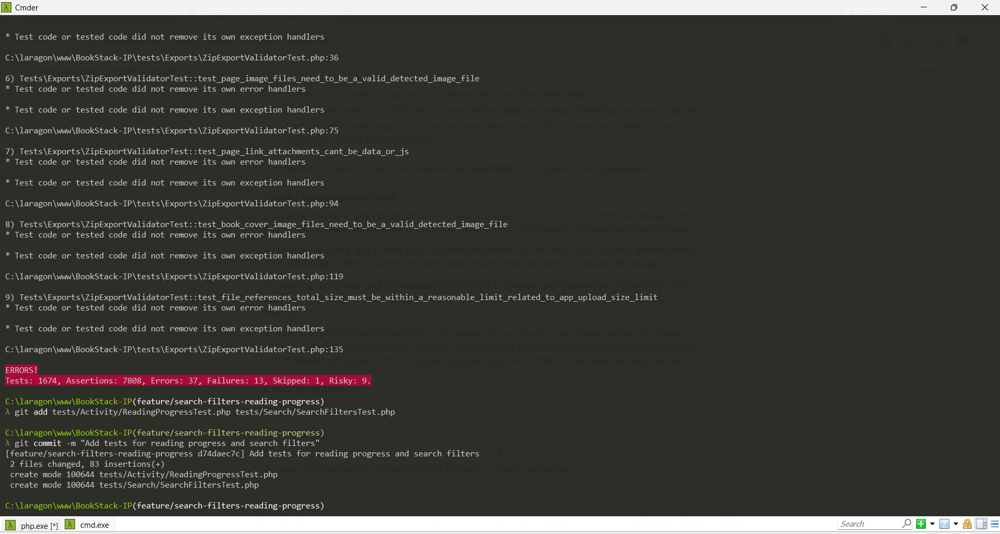

# BookStack – Enhanced Search Filters & Reading Progress Tracker

**Candidate:** Prathip M
**Program:** Praskla Technology – 2026 Internship, Final Technical Round
**Base project:** [BookStack](https://github.com/BookStackApp/BookStack) (Laravel / PHP)
**Branch:** `feature/search-filters-reading-progress`

| Task | Summary |
|---|---|
| Modification | Enhanced search with **author**, **tag**, **date** and **workspace (shelf / book)** filters |
| New feature | **Reading Progress Tracker** – recently viewed, continue reading and completion percentage per book |

---

## 1. Project Setup

Tested on Windows with Laragon (PHP 8.3, MySQL, Node.js, Composer, Git).

### Requirements
- PHP 8.3+ with extensions: `curl`, `dom`, `fileinfo`, `gd`, `mbstring`, `pdo_mysql`, `xml`, `zip`
- Composer, MySQL / MariaDB, Node.js + npm, Git

### Steps
```bash
git clone https://github.com/Prathip2826/BookStack-IP.git
cd BookStack-IP
git checkout feature/search-filters-reading-progress

# Databases (app + tests)
mysql -u root -e "CREATE DATABASE bookstack;"
mysql -u root -e "CREATE DATABASE `bookstack-test`;"
mysql -u root -e "CREATE USER 'bookstack-test'@'%' IDENTIFIED BY 'bookstack-test';"
mysql -u root -e "GRANT ALL ON `bookstack-test`.* TO 'bookstack-test'@'%'; FLUSH PRIVILEGES;"

# Configuration
copy .env.example .env      # cp on Linux/macOS
# edit .env: APP_URL=http://localhost:8000, DB_HOST=127.0.0.1,
#            DB_DATABASE=bookstack, DB_USERNAME=root, DB_PASSWORD=

composer install
php artisan key:generate
php artisan migrate
npm install
npm run build
php artisan serve
```
Open http://localhost:8000 and log in with `admin@admin.com` / `password`.

### Running tests
```bash
php artisan migrate --database=mysql_testing
php artisan db:seed --class=DummyContentSeeder --database=mysql_testing
php vendor/bin/phpunit
```

---

## 2. Database Structure & Understanding

Since 2025, BookStack stores all content types in a **single `entities` table**, with type-specific data split into side tables.

| Table | Purpose | Key columns |
|---|---|---|
| `entities` | All books, chapters, pages and shelves | `id`, `type` (`book` / `chapter` / `page` / `bookshelf`), `name`, `slug`, `book_id`, `chapter_id`, `created_by`, `updated_by`, `owned_by`, timestamps |
| `entity_page_data` | Page content | `page_id`, `html`, `text`, `markdown`, `draft`, `template` |
| `entity_container_data` | Book / shelf details | `entity_id`, `entity_type`, `description`, `image_id` |
| `bookshelves_books` | Shelf ↔ book (many-to-many) | `bookshelf_id`, `book_id`, `order` |
| `tags` | Name/value tags on any entity (polymorphic) | `entity_id`, `entity_type`, `name`, `value` |
| `views` | Per-user, per-item view tracking (polymorphic) | `user_id`, `viewable_id`, `viewable_type`, `views` (count), `created_at` (first view), `updated_at` (last view) |
| `users`, `roles`, `role_user` | Users and their roles | |
| `joint_permissions` | Pre-computed "can this role see this entity" table | `role_id`, `entity_id`, `entity_type`, `status` |

### Relationships
```
Bookshelf ──< bookshelves_books >── Book ──< Chapter ──< Page
                                      └────────────────< Page   (pages directly in a book)
Entity ──< tags          (entity_id + entity_type)
Entity ──< views >── User (viewable_id + viewable_type)
User ──< entities.created_by / updated_by / owned_by
```

### How permissions work
Every list query goes through the `visible()` scope / `visibleForList()` methods, which join `joint_permissions` for the current user's roles. Both new features use these methods, so users never see, count or filter by content they are not allowed to view.

---

## 3. Modification – Enhanced Search Filters

### What was added
In the advanced search sidebar (`/search`):
- **Workspace → Shelf**: results limited to books on a shelf plus their chapters and pages
- **Workspace → Book**: results limited to one book's chapters and pages
- **Author → Created by**: results created by any chosen user (previously only "Created by me")
- **Tag** and **Date** filters already existed and work in combination with the new filters

All dropdown options are loaded from the database (users, and the shelves/books visible to the current user). Nothing is hardcoded.

The filters can also be typed directly into the search box:
```
{in_shelf:shelf-slug}   {in_book:book-slug}   {author:user-slug}
```

### How it works
BookStack's `SearchRunner::buildQuery()` converts each filter name into a method name (`in_shelf` → `filterInShelf`) and calls it if it exists. The new filters plug into this existing mechanism:

| File | Change |
|---|---|
| `app/Search/SearchRunner.php` | Added `filterAuthor()`, `filterInShelf()`, `filterInBook()` |
| `app/Search/SearchController.php` | Passes `filterUsers`, `filterShelves`, `filterBooks` to the view |
| `resources/views/search/parts/select-filter.blade.php` | New reusable dropdown component (same style as `date-filter`) |
| `resources/views/search/all.blade.php` | Added Workspace and Author sections to the sidebar |
| `lang/en/entities.php` | New translation labels |

- `filterInShelf()` looks up the visible shelf, reads its book IDs from `bookshelves_books`, then matches `book_id IN (...)` (chapters/pages) **or** `type = book AND id IN (...)` (the books themselves).
- All filters support negation (`-{in_book:x}`) via the existing `applyNegatableWhere()` helper.
- Choosing "Any" sends an empty value, which `SearchOptions::fromRequest()` skips, so default search behaviour is unchanged.

---

## 4. New Feature – Reading Progress Tracker

Available from **profile menu → Reading Progress** (`/reading-progress`).

For each book the user has started reading it shows:
- **Completion %** with a progress bar and "X of Y pages read"
- **Continue reading** button that opens the last page viewed in that book
- A **Recently Viewed** list (reuses the existing `QueryRecentlyViewed`)

### Logic
- A page counts as **read** once the user has a row for it in the `views` table. BookStack already records this on every page view, so **no new table or migration was needed**.
- `completion % = pages viewed by user in book ÷ visible non-draft pages in book × 100`
- `continue reading = page in that book with the latest views.updated_at`
- Books are ordered by most recent reading activity.

| File | Purpose |
|---|---|
| `app/Entities/Queries/QueryReadingProgress.php` | Builds per-book progress data |
| `app/Activity/Controllers/ReadingProgressController.php` | Controller for the page |
| `routes/web.php` | `GET /reading-progress` (inside the authenticated route group) |
| `resources/views/reading-progress/index.blade.php` | Page view |
| `resources/sass/_blocks.scss` | Progress bar style |
| `resources/views/layouts/parts/header-user-menu.blade.php` | Menu link |
| `lang/en/entities.php` | Labels |

### Edge cases handled
- Guest users → empty list (BookStack does not record guest views)
- Books with 0 visible pages → 0%, no division by zero
- Draft pages are not counted
- Restricted pages/books are excluded via `visibleForList()`

---

## 5. Testing

New feature tests:
- `tests/Activity/ReadingProgressTest.php`: progress + continue link after viewing, empty state, menu link
- `tests/Search/SearchFiltersTest.php`: shelf filter, book filter (negative case), author filter, sidebar dropdowns

| Run | Tests | Errors | Failures |
|---|---|---|---|
| Original code (baseline, before changes) | 1667 | 37 | 13 |
| After changes | 1674 | 37 | 13 |

All 7 new tests pass, and the error/failure count is identical to the baseline, so no existing functionality was broken. The baseline errors are environment-specific to Windows (see Challenges).

---

## 6. Challenges & Solutions

| Challenge | Approach |
|---|---|
| **Unified `entities` table**: older guides refer to separate `books` / `pages` tables | Read the 2025 migrations (`create_entities_table`) and filtered on `type`, `book_id` and `id` |
| **Shelf filter needs a join**: shelves are not stored on pages | Fetched book IDs from `bookshelves_books`, then filtered pages/chapters by `book_id` and books by `id` |
| **Permissions**: restricted content must not leak via counts or dropdowns | Used `visible()` / `visibleForList()` everywhere instead of raw queries |
| **Divide by zero** for books with no pages | Returned 0% when the total is 0 |
| **Existing filters** (`created_by`) are only shown in the UI for "me" | Added a separate `author` filter so the existing behaviour is unchanged |
| **Windows test failures** on the original code (CRLF line endings, PDF export tool not installed, file paths) | Recorded the baseline before any change and verified the counts did not increase afterwards |

---

## 7. Screenshots

**Search sidebar with new filters**



**Shelf filter results**



**Reading Progress page**



**Test run (same errors/failures as baseline)**



---

---

## 8. Commit History
```
Add author, shelf and book filters to search runner
Pass users, shelves and books to search view for filter options
Add workspace and author filter dropdowns to search sidebar
Add reading progress query, controller and route
Add reading progress page, styles and user menu link
Add tests for reading progress and search filters
Add submission README and screenshots
```
